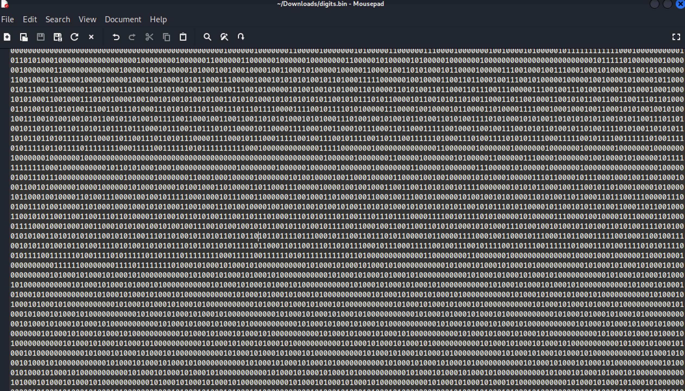
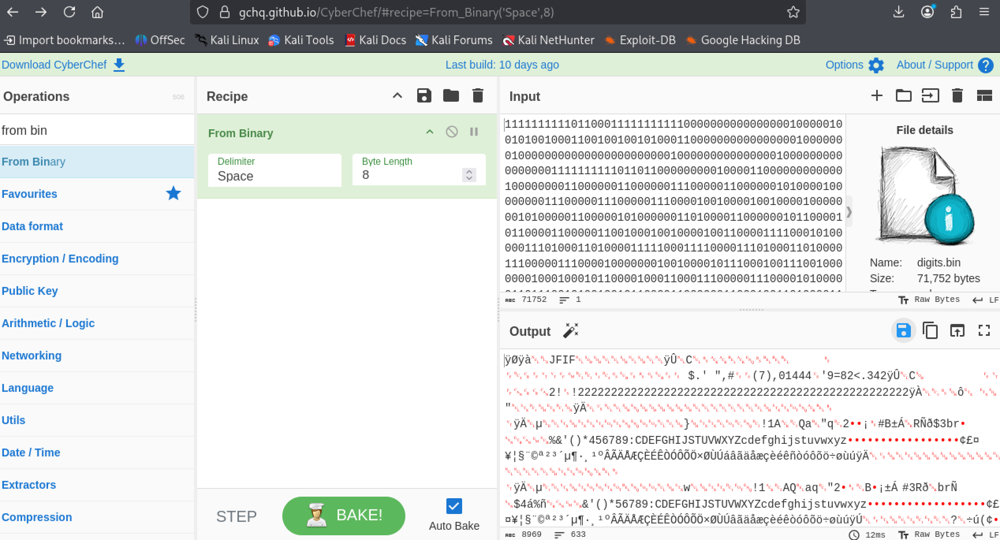
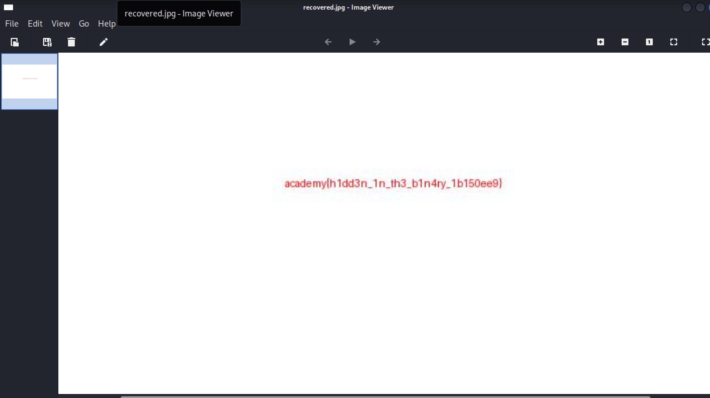

# PicoCTF – CyLab

## 1. Binary Digits

**Category:** Forensics  
**Level:** Easy
**Challenge Link:** [Binary Digits – PicoCTF CyLab 2026](https://learn.cylabacademy.org/library/698?page=1&category=4&workspace=true)

### Steps to Solve

1. Download the binary file and open the [CyberChef website](https://gchq.github.io/CyberChef/).

    

2. Upload the binary file under the **Input** section.

3. From the **Operations** menu, drag and drop **From Binary** into the **Recipe** section.

4. Set the following values in the Recipe menu:

   - **Delimiter:** Space
   - **Byte Length:** 8
    
    


5. Save the output by clicking the **Save** button. A `.jpeg` file is generated.

6. Open the recovered image. The flag is displayed in the image.

   

### Flag

```text
academy{h1dd3n_1n_th3_b1n4ry_1b150ee9}
```
