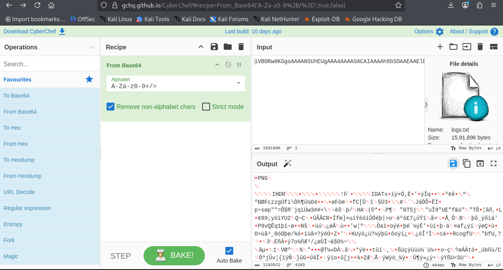
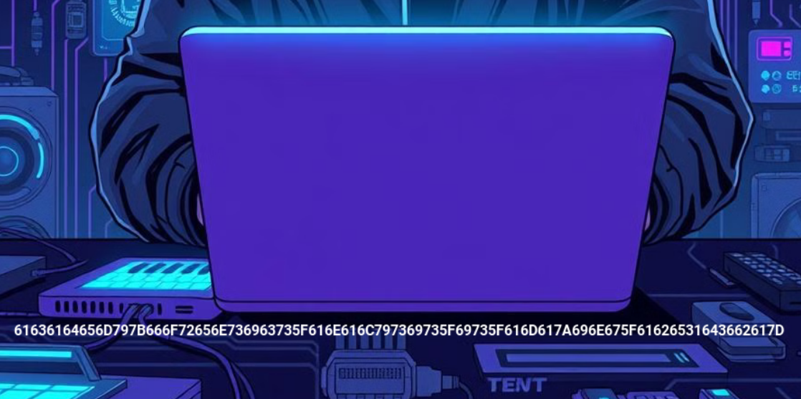
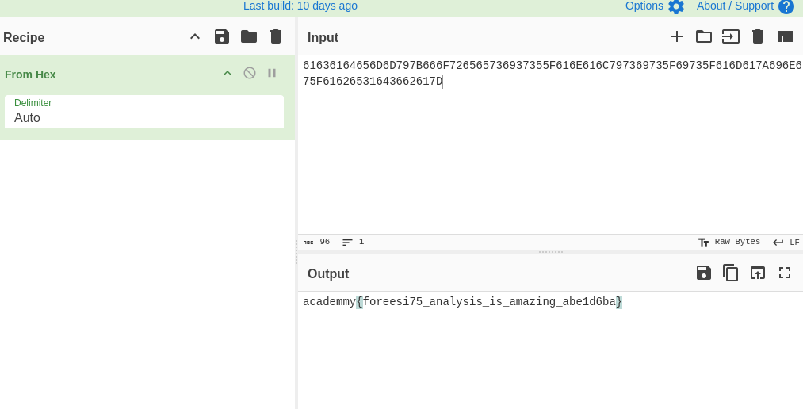

# Flag in Flame

**Category:** Forensics  
**Difficulty:** Easy

**Challenge Link:** [Flag in Flame](https://learn.cylabacademy.org/library/524?page=1&category=4&workspace=true)

## Solution

### Step 1: Download the file

Download `logs.txt` from the challenge.

### Step 2: Decode Base64 using CyberChef

1. Open [CyberChef](https://gchq.github.io/CyberChef/).
2. Upload `logs.txt` under the Input section.
3. Search for **From Base64** in the Operations menu.
4. Drag and drop it into the Recipe section.

    

5. The decoded output generates image data.
6. Click the Save button to download the generated image as a JPG file.

### Step 3: Find the hexadecimal string

1. Open the downloaded image.
2. Zoom in at the bottom of the image.

  

3. Observe the hexadecimal code.
4. Copy the entire hexadecimal string.

### Step 4: Decode hexadecimal

1. Paste the copied code into CyberChef Input.
2. Search for **From Hex**.
3. Drag and drop it into the Recipe section.
4. The decoded output displays the flag.

   

## Flag

```text
academy{forensics_analysis_is_amazing_abe1d6ba}
