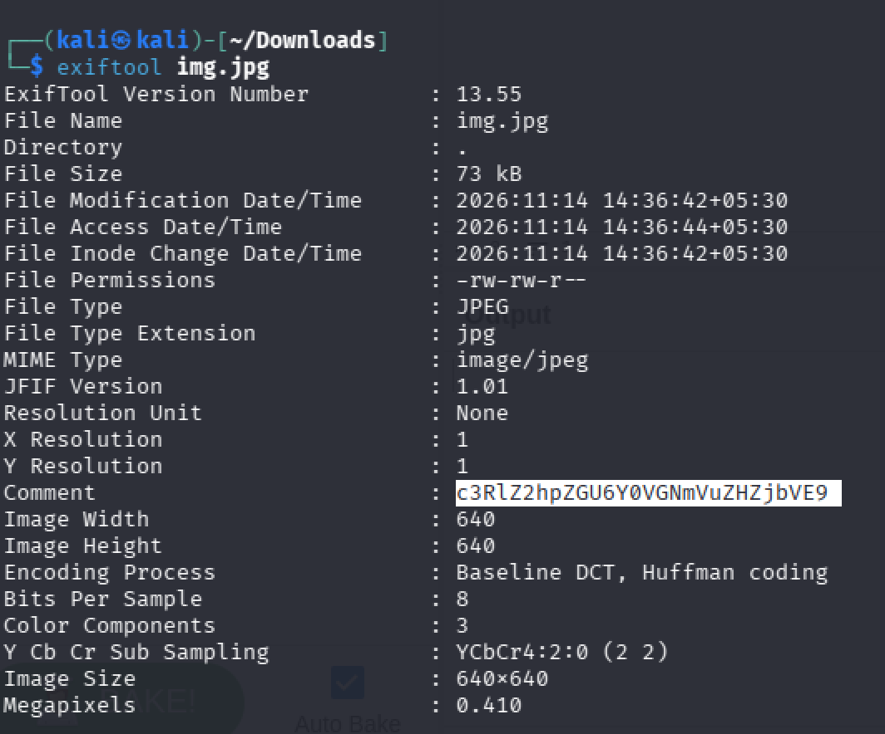
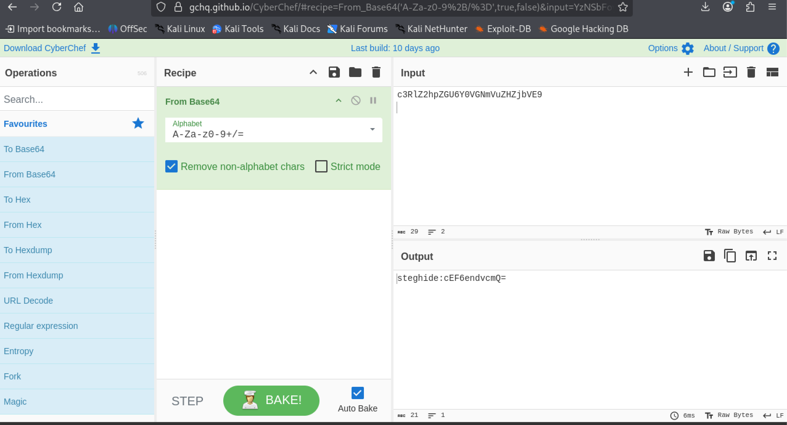
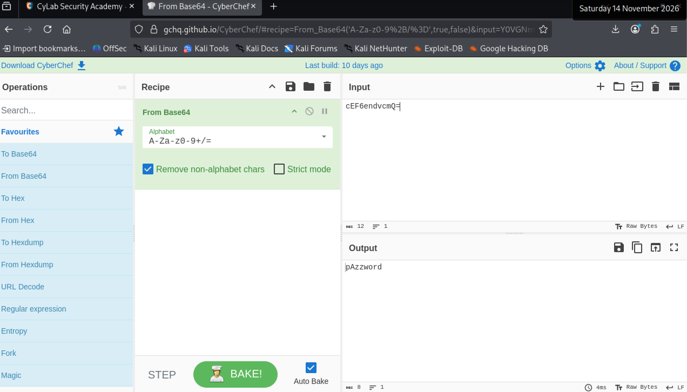
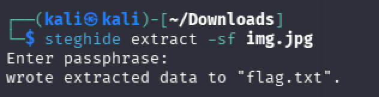
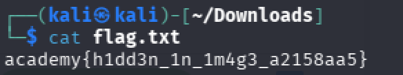

# Hidden in Plain Sight

**Category:** Forensics  
**Difficulty:** Easy
**Challenge Link:** [Hidden in Plain Sight](https://learn.cylabacademy.org/library/524?page=1&category=4&workspace=true)

## Solution

### Step 1: Download the image

Download `img.jpg` from the challenge.

### Step 2: Inspect image metadata

Run the following command:

```bash
exiftool img.jpg
```



- Check the `Comment` field.
- The comment contains suspicious encoded text.
- Copy the comment value.

### Step 3: Decode the Base64 text

1. Open [CyberChef](https://gchq.github.io/CyberChef/).
2. Paste the comment value into the Input field.
3. Search for **From Base64**.
4. Drag it into the Recipe section.
5. Check the decoded output.



The output reveals two clues:

- `steghide` – A tool used to hide data inside image or audio files.
- `CEF6endVem0=` – Another Base64-encoded string.

### Step 4: Decode the password

1. Copy `CEF6endVem0=`.
2. Paste it into CyberChef.
3. Apply **From Base64**.



The decoded password is:

```text
pAzzword
```

### Step 5: Install Steghide

In Kali Linux terminal, run:

```bash
sudo apt install steghide
```

To understand its available options, run:

```bash
steghide --help
```

### Step 6: Extract the hidden file

Navigate to the directory containing `img.jpg`:

```bash
cd ~/Downloads
```

Run:

```bash
steghide extract -sf img.jpg
```

When prompted for the passphrase, enter:

```text
pAzzword
```



A file named `flag.txt` will be extracted.

### Step 7: Read the flag

Run:

```bash
cat flag.txt
```



The flag will be displayed in the terminal.

## Flag

```text
academy{h1dd3n_1n_1m4g3_a2b58aa5}
```
