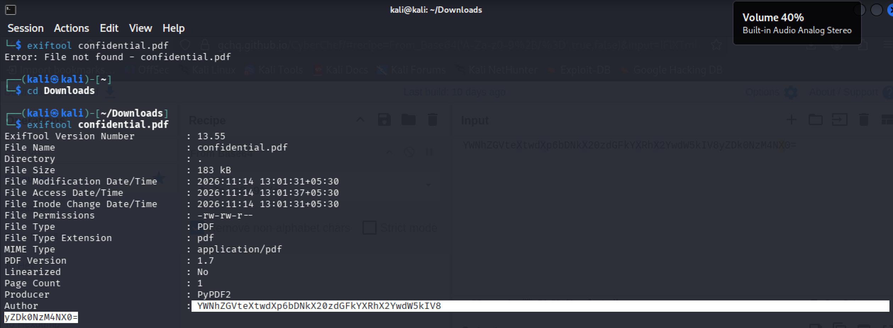
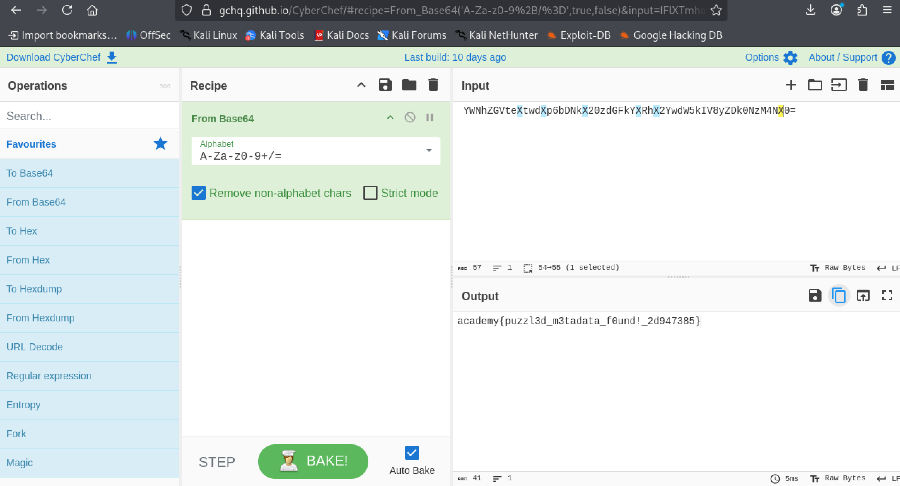

# Riddle Registry

**Category:** Forensics  
**Level:** Easy
**Challenge Link:** [Riddle Registry – PicoCTF CyLab 2026](https://learn.cylabacademy.org/library/530?page=1&category=4&workspace=true)

## Steps to Solve

1. Download `confidential.pdf` from the challenge.

2. Open the Kali Linux terminal and navigate to the Downloads folder:

   ```bash
   cd Downloads
   ```

3. Run ExifTool to extract the PDF metadata:

   ```bash
   exiftool confidential.pdf
   ```
      

4. Observe the **Author** field in the metadata. The author's name looks suspicious and does not appear to be normal text.

5. Identify that the author's name is Base64 encoded.

6. Copy the suspicious string and paste it into the **Input** field of [CyberChef](https://gchq.github.io/CyberChef/).

7. From the Operations menu, drag and drop **From Base64** into the Recipe section.

8. The decoded flag will be displayed in the CyberChef Output section.

   

## Flag

```text
academy{puzzl3d_m3tadata_found!_2d94783?}
```
